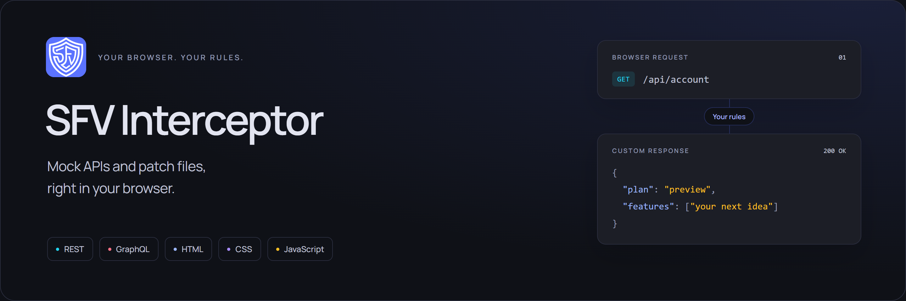
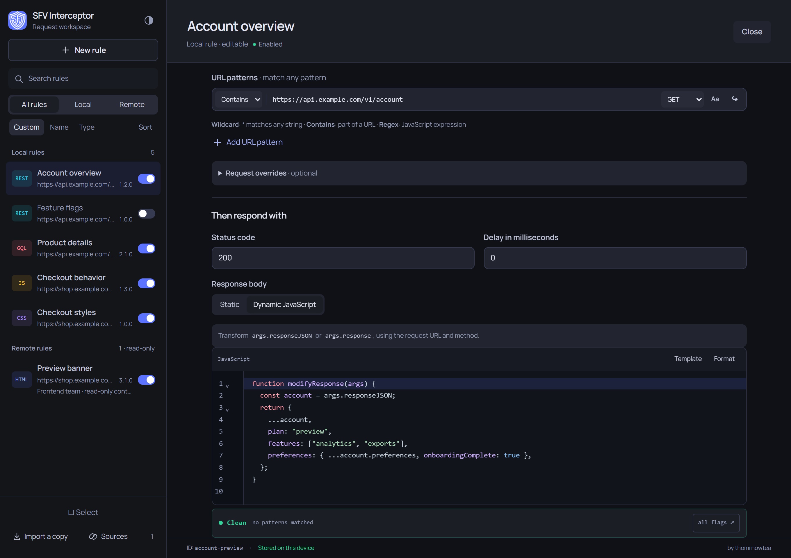
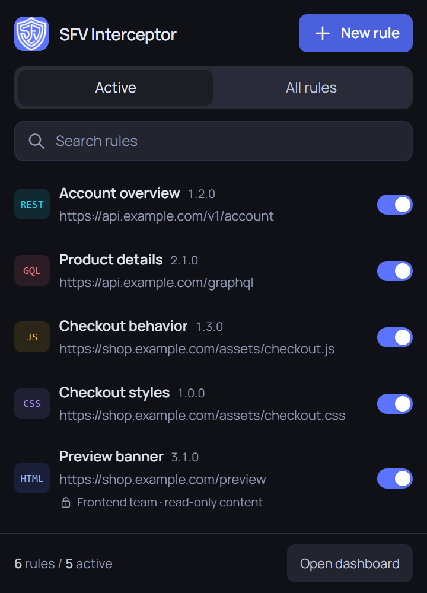

# SFV Interceptor

Intercept, mock, and modify HTTP requests in real time — directly in Chrome, no account, no proxy, no server required.

---

## Overview

SFV Interceptor is a Manifest V3 Chrome extension that lets developers intercept REST and GraphQL API calls, patch JS and CSS files, and inject code into pages — all from the browser. API rule changes are pushed to open tabs; file replacements and page injections run on subsequent navigation. It is designed for frontend developers who need to mock APIs, test edge cases, or patch third-party scripts during development.

---

## Interface

The dashboard brings local rules, remote subscriptions, matching, and code editing into one workspace. The popup provides activation switches and quick access to the dashboard.

  

The captures use sample rules. The extension starts with an empty workspace.

---

## Features

### API Mocking
- Intercept `fetch` and `XMLHttpRequest` calls for REST and GraphQL endpoints
- Static responses — return a fixed body; the real request still appears in DevTools
- Dynamic responses — write a `modifyResponse(ctx)` JS function to transform the real response
- GraphQL operation name filter — target specific queries or mutations
- HTTP method filter — restrict a rule to `GET`, `POST`, `PUT`, `DELETE`, etc.
- Custom status code and simulated response delay (ms)
- Custom request headers injected per rule

### File Patching
- Replace or modify JS and CSS files before the page executes them
- Inject arbitrary JS or HTML directly into a page at load time
- Uses `declarativeNetRequest` to block the original file and serve the patched version

### Rule Management
- Multiple URL patterns per rule, sharing its response configuration
- URL match operators: `Contains`, `Equals`, `Wildcard`, `Regex`
- Enable/disable toggles for local and remote rules; remote activation is a persistent local preference
- Drag-to-reorder rules with custom sort order
- Sort rules by name or resource type
- Bulk select and export; bulk deletion applies to local rules
- Import/export rules as JSON — standard format
- Import from a local file or a remote URL
- One-time imports create editable local copies; remote subscriptions are a separate workflow
- Read-only remote sources with configurable background synchronization and manual refresh
- Per-rule versions: editable locally, published by the JSON source for remote rules

### Editor & UI
- CodeMirror editor with JavaScript syntax highlighting for dynamic responses
- Prettier formatting for JavaScript, JSON, HTML, and CSS, with keyboard support and CodeMirror undo
- Security analysis warns on dangerous code patterns before saving
- Custom themes — built-in dark/light presets plus a fully custom color picker
- Popup: search, Active / All Rules tabs, per-rule toggle and a New rule shortcut to the dashboard
- Dashboard: sidebar rule list + full rule editor panel
- Manrope bundled locally, original dark palette and light/custom themes
- Compact popup with a single scrolling list; dedicated rule browser on narrow screens
- Accessible native dialogs, keyboard navigation, and reduced-motion feedback
- Origin filters and visible source/version information for remote rules

---

## How It Works

When a page loads, `content.js` runs in the isolated world at `document_start` and asks the service worker for any enabled API rules. If rules exist, it injects `page-hook.js` into the page's MAIN world via `chrome.scripting.executeScript`, where it captures the native `fetch` and `XMLHttpRequest` before any page script runs. When a request URL matches a rule, the hook returns the configured static body or passes the real response through the user-defined `modifyResponse` function. For JS and CSS file patching, the service worker uses `declarativeNetRequest` to block the original file on navigation and re-executes a patched version directly in the MAIN world. Saving or toggling a local rule, or syncing a remote source, pushes updated API configuration to open tabs. Reload a page to apply changed file replacements or page injections.

---

## Installation

For a release build, download the versioned **sfv-interceptor-vX.Y.Z.zip** asset from [GitHub Releases](https://github.com/thomrnowtea/sfv-interceptor/releases), then load it as an unpacked extension:

1. Extract the extension ZIP into a permanent folder
2. Open Chrome and navigate to `chrome://extensions`
3. Enable **Developer mode** using the toggle in the top-right corner
4. Click **Load unpacked**
5. Select the extracted folder containing `manifest.json`

The SFV Interceptor icon will appear in the Chrome toolbar.

No Node installation or build is needed. For updates, replace the files in the same folder and reload the installed extension. Developers can also load this repository directly. See [release packaging and publishing](docs/releases.md) for the local ZIP command and automated tag releases.

---

## How to Use

### Using the Popup

1. Click the SFV Interceptor icon in the toolbar to open the popup
2. Switch between the **Active** and **All Rules** tabs to filter the list
3. Use the search bar to find a rule by name or URL pattern
4. Toggle a local or remote rule's switch to enable or disable it instantly
5. Click **Open dashboard** to edit local rules, inspect remote content, or adjust settings
6. Click **+ New Rule** to create a rule and open the dashboard editor

### Using the Dashboard

1. Open the dashboard from the popup via **Open dashboard**. Popup rule rows only offer enable/disable switches; the header's **New rule** shortcut opens creation in the dashboard
2. Click **+ New Rule** in the sidebar to start a new rule
3. Set a name, select the resource type (REST, GraphQL, JS, CSS, HTML), and enter one or more URL patterns
4. Choose a response type — **Static** for a fixed body, **Dynamic** to write a `modifyResponse` JS function
5. Click **Create rule** or **Save changes** — API changes are pushed to open tabs; file changes apply on navigation
6. To create editable copies, click **Import a copy** and choose a JSON file or import once from a URL
7. To follow a published collection, open **Sources → Add source**, enter any HTTPS URL whose response is rule JSON, and choose a polling interval in minutes. A `.json` filename is not required; ETag/304 avoids downloading unchanged responses when the server supports it
8. Edit a local rule's **Version** field as needed. Remote content and versions follow their source JSON; use the popup or sidebar switch to turn each remote rule on or off locally

Remote sources never write into local rule storage. A successful sync reflects additions, changes, and removals in the complete source document. A failed sync keeps the last valid snapshot and displays an error. Unsubscribing removes only that source's remote rules. Background updates use Chrome alarms and may be delayed while the browser or device is asleep.

Each remote rule needs a stable `id`; both `[rules...]` and `{ "rules": [...] }` JSON documents are supported. See the [rule schema](docs/rule-schema.md) for a complete example.

## Development

No particular assistant, editor, or local configuration is required. Run `npm test`, `npm run check`, `npm run test:browser`, and `npm run test:ui` to verify behavior, syntax, and the real extension UI. `npm run test:popup` opens the actual native toolbar popup; `npm run test:formatter` checks Prettier inside the extension. `npm run test:activity` checks the per-page applied indicator and actual interception outcomes. See [development instructions](docs/development.md), the [design guide](docs/design-system.md), and the [QA report](docs/qa.md).

---

## License

MIT
