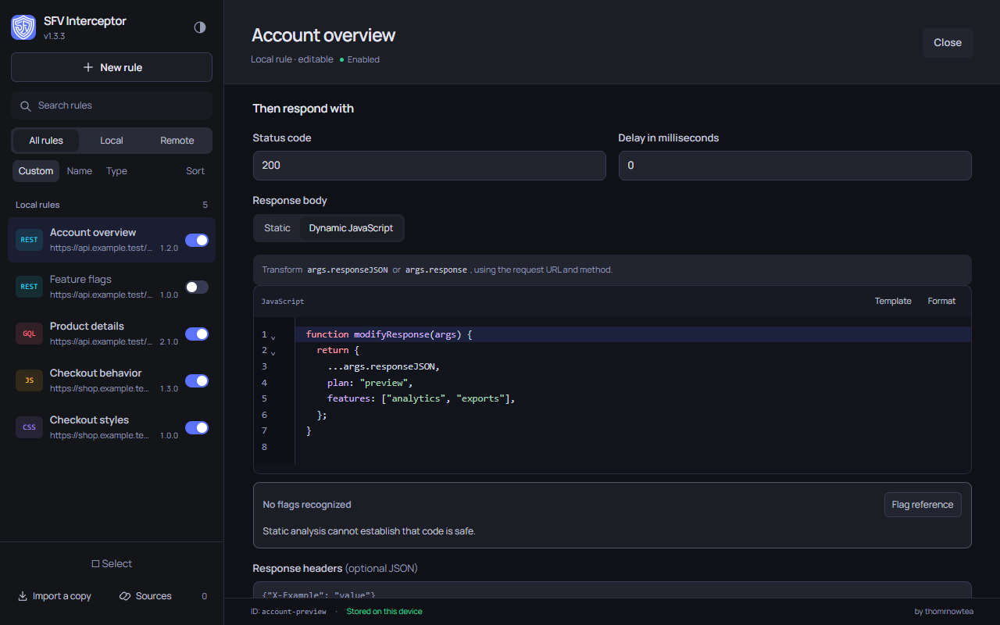
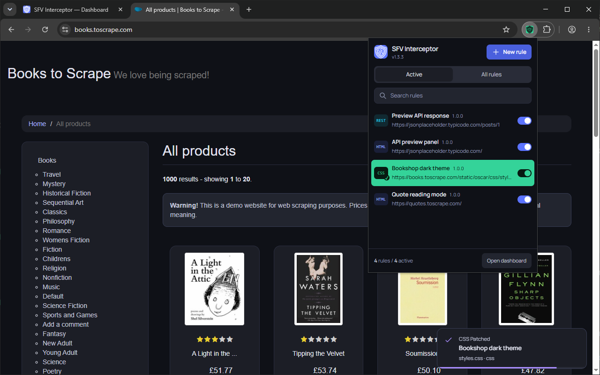

  

<h1 align="center">SFV Interceptor</h1>

Mock API responses, replace JavaScript and CSS files, and customize web pages.

  
  
  

  <a href="#installation">Installation</a> ·
  <a href="#features">Features</a> ·
  <a href="https://github.com/thomrnowtea/sfv-interceptor/issues">Support</a> ·
  <a href="PRIVACY.md">Privacy</a>

## Features

| Feature | What you can do |
| --- | --- |
| **REST & GraphQL** | Mock response bodies, status codes, headers, and delays. Transform requests and responses with JavaScript. |
| **HTML, JavaScript & CSS** | Run page code and replace JS/CSS resources with static content or transformations of the original. |
| **Local rules** | Create, edit, version, search, and organize your rules. |
| **Subscriptions** | Keep rules updated from a URL. The publisher maintains content and versions; you control activation. |
| **Import & export** | Exchange JSON files or import a copy from an HTTPS URL. Local copies remain editable and independent. |
| **Popup & dashboard** | Toggle rules and see which ran on the current page. Edit rules and manage sources in the dashboard. |

## Screenshots

## Installation

### Chrome Web Store (recommended)

Open [SFV Interceptor in the Chrome Web Store](https://chromewebstore.google.com/detail/sfv-interceptor/ecegpdejljnflaiibflhfofjmfnpponc) and click **Add to Chrome**. Chrome installs future updates automatically.

### ZIP (alternative)

Install manually from GitHub Releases:

1. Open the [latest release](https://github.com/thomrnowtea/sfv-interceptor/releases/latest) and download **sfv-interceptor-vX.X.X.zip** under **Assets**.
2. Extract it to a folder you will keep on your computer.
3. Open `chrome://extensions` and turn on **Developer mode**.
4. Select **Load unpacked** and choose the extracted folder containing `manifest.json`.

Updating a ZIP installation

1. Download and extract the new extension ZIP.
2. Copy its contents into your existing installation folder, replacing the old files.
3. Open `chrome://extensions` and click **Reload** (the circular-arrow button) on SFV Interceptor.
4. Refresh the websites where you use it and the dashboard tab if it is open.

Keep the same folder and installed extension to preserve your saved rules and settings.

## Quick start

Click the extension icon and choose **New rule**, or open the **dashboard** to manage existing rules. Choose the rule type and matching URLs, set its content, save it, and turn it on. Refresh the website for page and file rules to take effect.

**Import a copy** adds editable local rules from a file or URL. **Sources** keeps rules linked to a URL for automatic updates. Subscribed content is read-only; each rule can still be turned on or off.

See the [rule format](docs/rule-schema.md) when creating or sharing JSON rule files.

## Privacy and permissions

Rules and preferences are stored in your browser. Subscriptions check the URLs you add. The extension has no account system or analytics.

Website access lets the extension apply your rules; you can restrict that access in Chrome's extension settings. The [privacy policy](PRIVACY.md) explains local processing, network connections, and data controls.

## Development

The extension loads directly from this repository without a build step. See the [development guide](docs/development.md) for checks and the [release guide](docs/releases.md) for packaging.

## License

[MIT](LICENSE)
